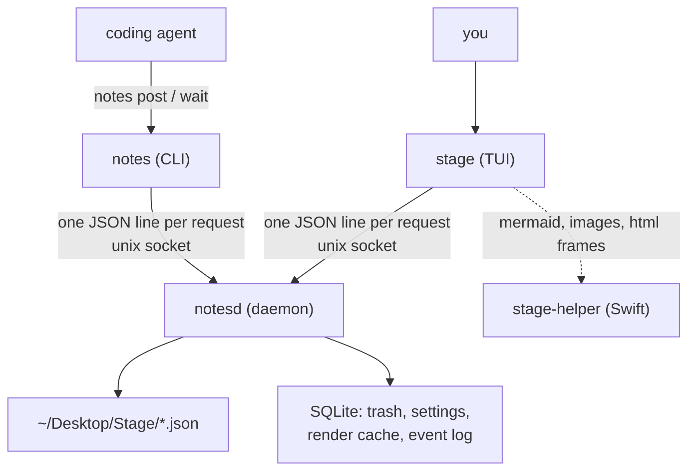

# stage

A terminal pane where coding agents show you things: diagrams, diffs, plans, terminal
output, JSON and live HTML, posted as cards you read and comment on. Your comments go back
to the agent. It's [sideshow](https://github.com/modem-dev/sideshow)'s parts and design
guide, rebuilt as a native terminal app. One Rust daemon owns the data, and the `notes` CLI
and the `stage` TUI are thin clients over a unix socket.

macOS 26+, Apple Silicon.

## Install

```sh
curl -fsSL https://raw.githubusercontent.com/tridha643/notes/main/install.sh | sh
```

This downloads the latest release into `~/.local/bin` (`notesd`, `notes`, `stage`,
`stage-helper`), registers the `notesd` LaunchAgent, copies the stage skill into every agent
skills folder it finds (`~/.claude/skills`, `~/.codex/skills`, `~/.pi/agent/skills`,
`~/.agents/skills`), and ends with `notes doctor`. Run it again to upgrade. Pin a version with
`STAGE_VERSION=v0.1.0`.

Then open a terminal pane beside your agent and run `stage`. Diagrams, images and HTML need a
terminal that speaks the kitty graphics protocol.

## Agent setup

Agents that read a skills folder (Claude Code, Codex, pi) already have the `stage` skill after
the install. For any other agent, paste the block `notes setup` prints into its `AGENTS.md` or
`CLAUDE.md`:

```sh
notes setup >> AGENTS.md
```

Agents learn the rest from the installed CLI, so the instructions always match the binary.
`notes agent-howto` covers posting, revising and reading comments. `notes guide` is the design
guide, sideshow's adapted to stage, ending with the live size of your card. Before sending,
`notes post` checks each post against that card and refuses one that won't render or fit,
such as a Mermaid diagram that doesn't parse. The `error:` lines tell the agent what to fix.

```sh
notes post mermaid flow.mmd --title "Request flow" --session-title "Auth refactor"
git diff --no-color | notes post diff - --title "Retry on 429"
notes wait            # block until you comment
```

## Architecture



- **notesd is the only writer.** launchd starts it on the first socket connection, and it
  sits idle until a client talks (kqueue, no timers). It renders too. Code highlighting, diff
  hunks and ANSI are computed once and cached by content hash.
- **Agents never pick a session.** `notes` finds the agent process that called it, and each
  conversation gets its own thread of posts. Comments you leave in stage come back to the
  agent on its next `notes post` or `notes wait`.
- **stage-helper draws what a terminal can't.** It runs Mermaid through pele in
  JavaScriptCore, decodes images, and runs HTML parts live in an offscreen WebKit view. Stage
  shows the results with kitty graphics.

## Layout

| Path | What |
|---|---|
| `crates/daemon` | `notesd`: sessions, SQLite, socket server ([README](crates/daemon/README.md)) |
| `crates/posts` | posts engine: sessions, posts, comments, rendering ([README](crates/posts/README.md)) |
| `crates/proto` | wire protocol shared by every client ([README](crates/proto/README.md)) |
| `crates/cli` | `notes`, the CLI agents use, plus the design guide ([README](crates/cli/README.md)) |
| `crates/stage` | `stage`, the ratatui TUI ([README](crates/stage/README.md)) |
| `apps/Notes` | `stage-helper` (Swift) ([README](apps/Notes/README.md)) |
| `skills/stage` | the agent skill the installer copies |
| `install.sh` | the curl installer |
| `scripts/` | `install.sh` (from source), `dist.sh`, `release.sh`, latency and load tests |
| `docs/` | `cli-spec.md` (the protocol), `stage-plan.md`, `bench/` |

## Develop

Needs Xcode and Rust 1.88+ from [rustup](https://rustup.rs).

```sh
cargo build && cargo test          # Rust workspace
cd apps/Notes && swift test        # stage-helper
scripts/install.sh                 # build from this checkout and install it
scripts/stage-latency.sh           # publish→paint p95 must stay under 250 ms
```

Tests run their own `notesd` on temp dirs, so your sessions are untouched. Agents working on
this repo should read [AGENTS.md](AGENTS.md).

## Release

```sh
scripts/release.sh v0.1.0
```

This builds on your Mac, tars `bin/` and `skills/` into `stage-macos-arm64.tar.gz`, and
publishes a GitHub release for the current commit with that tarball and `install.sh`. The
curl installer always fetches the latest release, so push the commit first.

## Linux

Not yet. `notesd` uses kqueue and launchd socket activation, and `stage-helper` uses WebKit
and JavaScriptCore. A port needs an inotify watcher, a systemd socket unit and XDG paths.
Stage would run without the helper, minus Mermaid, images and HTML.
