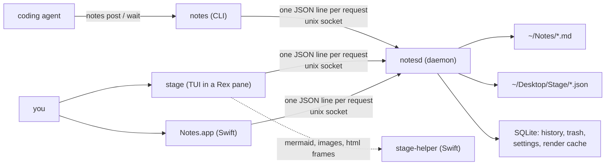

# notes + stage

Plain-markdown notes and **stage**, a terminal pane where coding agents post diagrams, diffs,
plans, terminal output and live HTML for you to read and comment on. One Rust daemon owns all
the data; the CLI, the stage TUI and the macOS app are thin clients over a unix socket.

macOS 26+, Apple Silicon. Linux isn't supported yet (see [Linux](#linux)).

## Architecture



- **notesd** is the only writer. launchd starts it on the first socket connection; it sits idle
  until a client talks or the vault changes (kqueue, no timers). It also renders: code
  highlighting, diff hunks and ANSI are computed once and cached by content hash.
- **Every client speaks the same protocol** (`crates/proto`), so anything the app can do,
  the CLI can do with `--json`.
- **Agents never pick a session.** `notes` finds the agent process that called it, and each
  conversation gets its own thread of posts. Comments you leave in stage come back to the
  agent on its next `notes post` or `notes wait`.

## Layout

| Path | What | Details |
|---|---|---|
| `crates/daemon` | `notesd`: vault, SQLite, search, socket server | [README](crates/daemon/README.md) |
| `crates/posts` | sideshow engine: sessions, posts, comments, rendering | [README](crates/posts/README.md) |
| `crates/proto` | wire protocol types shared by every client | [README](crates/proto/README.md) |
| `crates/cli` | `notes`, the CLI agents and scripts use | [README](crates/cli/README.md) |
| `crates/stage` | `stage`, the ratatui TUI | [README](crates/stage/README.md) |
| `apps/Notes` | Notes.app (AppKit) and `stage-helper` | [README](apps/Notes/README.md) |
| `skills/stage` | agent skill that points agents at `notes post` | |
| `scripts/` | `install.sh`, `build-app.sh`, `stage-latency.sh` | |
| `docs/` | `cli-spec.md` (the protocol), `stage-plan.md`, `bench/`, `research/` | |
| `spikes/` | one-off experiments, kept for their measurements | |

## Install

Needs Xcode (for Swift) and Rust 1.88+ from [rustup](https://rustup.rs).

```sh
scripts/install.sh
```

This builds `notesd`, `notes`, `stage` and `stage-helper` into `~/.local/bin`, registers the
`notesd` LaunchAgent, copies the stage skill into every agent skills folder it finds, and ends
with `notes doctor`. Run it again to upgrade. For the app: `scripts/build-app.sh` →
`build/Notes.app`.

Then open a terminal pane and run `stage`.

## Agent setup

Once the install script has run, agents that read a skills folder (Claude Code, Codex, pi,
`~/.agents`) already have the `stage` skill. For any other agent, paste this into its
`AGENTS.md` / `CLAUDE.md`:

```sh
notes setup >> AGENTS.md
```

Agents learn the rest from the installed CLI, so instructions never drift from the binary:
`notes agent-howto` covers posting, revising and reading comments, and `notes guide` covers
how posts should look.

Agents working *on this repo* should read [AGENTS.md](AGENTS.md).

## Develop

```sh
cargo build && cargo test          # Rust workspace
cd apps/Notes && swift test        # Swift
scripts/stage-latency.sh           # publish→paint p95 must stay under 250 ms
```

Tests run their own `notesd` on temp dirs, so your vault and sessions are untouched.

## Linux

Not yet. `notesd` uses kqueue and launchd socket activation, and `stage-helper` uses
WebKit/JavaScriptCore. A port needs an inotify watcher, a systemd socket unit and XDG paths;
stage would run without the helper, minus mermaid, images and HTML snapshots.
`scripts/install.sh` stops with this message on Linux.
