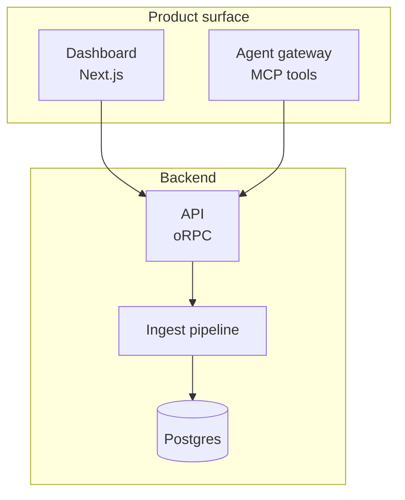

# stage: design guide for agents

You are drawing to a persistent visual surface the user keeps open in a
terminal pane beside you. Your posts appear instantly as cards, grouped into a
session for this conversation. Read this once before your first post. It is
sideshow's agent design guide, adapted to stage: `notes post` checks every post
against the user's card, refuses one that can't fit (an `error:` line says why,
and nothing is sent), and warns about the rest (`warning:` lines).

## Posts and parts

A **post** is a card built from an ordered list of **parts**. Each part has a
kind. Default to html: anything you'd draw, compare or lay out (a diagram, a
before and after, a flow, a sketch, a status view) is an html part with inline
SVG. The other kinds are for prose and for data you already have.

- **`html`**: arbitrary markup you write, run live in an offscreen web view
  whose frames stream into the pane, so animation works. The rest of this guide
  is the contract for it. Reach for it for diagrams, UI sketches, data viz,
  anything you draw.
- **`markdown`**: prose you hand over as text; stage renders it with consistent
  typography (headings, lists, tables, links, and highlighted fenced code; tag
  the fence with a language, e.g. ` ```ts `). Reach for it for explanations,
  plans and tradeoff write-ups, anything you'd otherwise hand-format in html.
- **`mermaid`**: diagram source you hand over as text; stage renders it to an
  SVG (flowcharts, sequence diagrams, ERDs, gantt, state, ...). Reach for it
  only for a sequence diagram, ERD or gantt, or a graph too big to place by
  hand. Anything else reads better as inline `<svg>` in an html part, where you
  choose the layout and what to emphasize. stage themes the diagram, so don't
  set your own colors.
- **`diff`**: a unified or git patch you hand over as data; stage renders it as
  a highlighted code review. Reach for it to show a changeset or review code,
  not to draw. Pipe it: `git diff --no-color -- src/retry.rs | notes post diff - --title "Retry on 429"`.
- **`code`**: source code you hand over as text, highlighted by language (from
  the file name, or `--language`). `--lines A:B` posts only those lines,
  numbered as in the file, so you can say "lines 80-150 of x.ts". Reach for it
  when a whole file or snippet is the point.
- **`terminal`**: monospace terminal output, rendered as a terminal window.
  ANSI SGR colors are kept. Reach for it to share shell output, build logs or
  example commands.
- **`json`**: any JSON value, rendered as a collapsible tree. Reach for it for
  API responses, config files and test results, any structured data where a
  tree beats a fenced code block.
- **`image`**: a screenshot or generated picture (`notes post image shot.png`
  uploads it first).

For an issue/PR/CI tree, status board or stepped deck, reach for an html part
with a kit (see Kits below) rather than a dedicated kind.

A post can combine parts: `[markdown, html]` is a short explanation above its
diagram, `[html, diff]` is a diagram with its code review in one card, and
`[markdown, diff]` is a written rationale above its changeset. To brief the
user on a PR or branch, follow `notes brief`.
Every kind except html is data stage renders for you; send data, never markup.

```sh
notes post html sketch.html --title "Cache layout"            # html
notes post markdown plan.md --title "Migration plan"          # markdown
notes post mermaid flow.mmd --title "Request flow"            # mermaid
notes post diff change.patch --title "Retry on 429"           # diff
notes post json data.json --title "API response"              # json
notes post code src/app.ts --lines 80:150 --title "app.ts"    # code excerpt
notes post image shot.png --title "Settings page"             # image
notes post markdown why.md --html flow.html --title "Retry flow"      # [markdown, html]
notes post html sketch.html --diff change.patch --title "Retry flow"   # [html, diff]
notes post markdown why.md --diff change.patch --title "Retry on 429"  # [markdown, diff]
```

More parts on one card: `--md F --mermaid F --code F --diff F --terminal F --html F`.

On your first post set a session title naming the task ("Auth refactor"), not
your tool, with `--session-title`; it applies only at creation. To refine a
post, update it (`notes post update <id> <kind> <file>`) rather than
publishing a near-duplicate: same card, new version, same place in the feed.

### Mermaid layout tips

Mermaid diagrams render inside the same card as everything else, so huge
left-to-right canvases are scaled down until the text is tiny. Optimize for the
card first:

- Default to `flowchart TD` or `flowchart TB`. Use `LR` only for short, truly
  linear flows with a handful of columns.
- Split whole-system architecture maps into several diagrams and posts:
  context, data flow, runtime and ownership are usually easier to read apart.
- Keep node labels short; put explanation in a markdown part above or below
  the diagram. Use `<br/>` in labels when a name needs wrapping.
- Use `subgraph` blocks to group layers vertically rather than stretching one
  row across the card.
- Quote any label with punctuation: `B["account_list<br/>qa@ accounts"]`, not
  `B[account_list<br/>qa@ accounts]`. An unquoted `name@` opens mermaid's
  `A@{ shape }` syntax and the diagram fails to parse. `notes post` parses
  every mermaid part first and refuses one that doesn't, with pele's line and
  caret.

Prefer this shape:



Avoid one-screen maps that put every package or service in a single
`flowchart LR` row; they fit the width by shrinking the text.

## Fit the card

A card is read without scrolling sideways. Its size follows the user's pane:
"Right now" at the end of this guide gives the live numbers, and `notes post`
holds every post to them.

- Text parts (markdown, code, diff, terminal, json) wrap at the card's width
  in cells. A markdown table wider than the card is refused: shorten cells or
  cut columns. Keep tables to 5 columns of a few words each.
- Markdown parts under 40 lines; past that, split into posts. Paragraphs
  under 60 words.
- html gets a fixed viewport: the card's width in CSS px, and up to the feed's
  height. A wider page is zoomed out until it fits, so its text shrinks;
  content below the height is cut off.
- mermaid lays out to the html width. A tall diagram scrolls; a wide one
  shrinks.
- Diffs read best unified. Use `--layout split` only on a card wider than 140
  cells.

## HTML contract

An html part is a blank canvas: invent the visualization the idea deserves.
Custom SVG, bespoke layouts, animation, an unusual way to show a relationship
are all fair game, and more useful than a safe diagram. The contract below is a
short list of hard constraints plus helpers (the built-in classes, kits and
theme tokens) that remove busywork and keep posts legible, not a push toward
one look. Reach for them when they fit; hand-roll freely when your idea is
better served another way.

- Send a body fragment (a whole document works too). stage wraps it in a page
  of its own with the theme tokens, base styles and SVG classes below. Your
  own CSS wins over all of them.
- Draw SVG as `<svg width="100%" viewBox="0 0 W H">` with W near the card's
  html width. It scales to the card; one taller than the viewport at that
  width is refused, so split it or make it wider than tall.
- No fixed `width` or `min-width` wider than the card; use % or `max-width`.
  Images and SVG with a viewBox already shrink to the card.
- Keep content in normal flow. Never use `position: fixed`, and no `vh`
  units: the page is measured to its content, so there's no viewport height
  to fill. To overlap elements (a cross-fading deck), grid-stack them:
  `display: grid` on the container, `grid-area: 1 / 1` on each child. The
  `slides` kit does exactly this; reach for it before hand-rolling a deck.
- `<style>` and `<script>` are allowed. One self-contained file, under
  512 KB, with no network: inline your CSS, SVG and images (`data:` URIs).
- The page takes clicks and drags in stage: buttons, `onclick` and pointer
  events work. There is no hover, only presses, drags and releases.
- Give an `id` to text and elements you'll change later. An update that only
  changes stylesheets, inline styles of elements with an id, or the text of
  identified leaf elements (headings, `p`, `span`, `li`, `a`, `button`,
  `label`) is patched in place, so animations and state keep running. Any
  other change reloads the page.

## Built-in kit: a head start, not a straitjacket

These primitives save you from restyling the basics; ignore any that don't
suit the picture you have in mind. Bare `button`, `input`, `select` and
`textarea` are pre-styled to match stage, so write the plain element.
Checkboxes, radios, ranges and progress bars are themed via `accent-color`.

SVG utility classes, available in every html part:

| class | effect |
|---|---|
| `t` / `ts` / `th` | text: 14px / 12px muted / 14px medium heading |
| `box` | neutral rect, secondary fill, faint stroke, rx 8 |
| `arr` | 1.2px connector line |
| `leader` | dashed guide line |
| `c-blue` `c-teal` `c-amber` `c-coral` | color ramp for shapes or a `<g>` |
| `c-green` `c-red` `c-gray` | same; child `<text>` gets readable ink |

A `<marker id="arrow">` is injected into every html part. End any line with
`marker-end="url(#arrow)"` and the arrowhead inherits the line's stroke color.

```html
<svg width="100%" viewBox="0 0 680 70">
  <g class="c-blue">
    <rect class="box" x="10" y="10" width="130" height="40" />
    <text class="th" x="75" y="35" text-anchor="middle">API</text>
  </g>
  <text class="ts" x="250" y="24" text-anchor="middle">202 + job id</text>
  <line class="arr" x1="140" y1="30" x2="360" y2="30" marker-end="url(#arrow)" />
</svg>
```

## Kits: opt-in component bundles

A kit is a richer vocabulary an html part opts into. Name kits with `--kit`
and the page gets that kit's CSS (and, for behavior kits, JS) on top of the
base, so you write compact class-based markup instead of hand-rolling styles.
A plain html part is untouched. `notes kits` lists them. Every class resolves
against the theme tokens.

- **`issues`**: `.card`, a nesting `.tree` rail, `.badge` (`.ok`/`.info`/`.warn`/`.danger`),
  `.dot`, mono `.chip`, a `.bar > i` rollup, plus layout (`.row`/`.stack`/`.between`/`.grow`)
  and text (`.dim`/`.faint`/`.mono`/`.title`) helpers. Composes an issue/PR/CI
  tree (nest a `.tree` inside a `.tree` to indent) or a status board.
- **`slides`**: author a `.deck` with `.slide` children; the kit cross-fades
  one at a time and injects prev/dots/counter/next controls.
- **`dragology`**: SVG the user drags. You declare the states an element can be
  dragged between; the library interpolates the drawing and snaps on drop. Write
  your code in `<script type="text/dragology">`: it runs once `dragology` (the
  library's exports plus `html`, htm tagged templates for JSX, and
  `mount(el, draggable, props)`) exists. Position with
  `transform=${translate(x, y)}`, never `x`/`y`, and name elements with `id`,
  never `key`. The state must be an object.

```sh
notes post html board.html --kit issues --title "CI status"   # repeatable: --kit a --kit b
```

```html
<div id="app"></div>
<script type="text/dragology">
const { html, mount, translate } = dragology;
const toggle = ({ state, d }) => html`
  <g transform=${translate(20, 20)}>
    <rect width="120" height="60" rx="30" fill="var(--color-background-secondary)" />
    <circle transform=${translate(state.on ? 90 : 30, 30)} r="24" fill="var(--color-text-info)"
      dragologyOnDrag=${() => d.between([{ on: false }, { on: true }])} />
  </g>`;
mount(document.getElementById("app"), toggle, { initialState: { on: false }, width: 160, height: 100 });
</script>
```

A kit only adds vocabulary; you can hand-roll custom markup right beside the
kit classes in the same part.

## Theming

Drive every color from the predefined CSS variables, a full semantic palette
to compose with, so posts stay legible on stage's dark card. Never hardcode
colors; `color: #333` is invisible on it.

- Backgrounds: `--color-background-primary|secondary|tertiary` and semantic
  `-info|-danger|-success|-warning`
- Text: `--color-text-primary|secondary|tertiary`, plus the same semantic variants
- Borders: `--color-border-tertiary` (default, faint), `-secondary`, `-primary`,
  plus semantic variants
- Fonts: `--font-sans|serif|mono`; radius: `--border-radius-md|lg|xl` (8/12/16px)

Mental test: if the background were near-black, would every element still read?

## Style

A few guardrails keep posts feeling native to stage. They shape the finish,
not the idea. Be as inventive as you like with structure, layout and how you
show a relationship; just land it in this register:

- Flat and clean: no gradients, drop shadows or decorative effects.
- Sentence case for titles, headings and labels ("Retry flow", not
  "Retry Flow"). No emoji.
- Two font weights only: 400 and 500.
- SVG works great. For diagrams use `<svg width="100%" viewBox="0 0 680 H">`
  with the classes above.
- Keep it focused: one concept per post. Publish a series of small posts with
  distinct titles rather than one giant page.

## Feedback

The user comments on a post with `c` in stage. Comments print on stderr as
`feedback:` lines after your next post write; treat them as messages from the
user. To block for one, run `notes wait`. Answer with a post update for
anything substantial.
